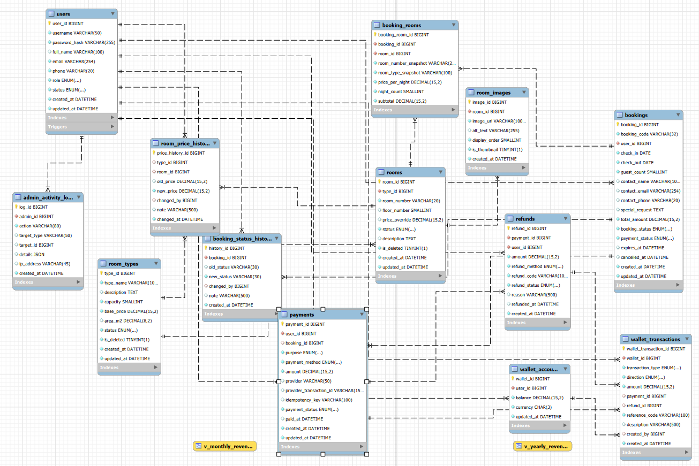

# 🌊 Hotel Sunrise Đà Nẵng (Sunrise Đà Nẵng)

<p align="center">
  <b>Hệ thống Quản lý và Đặt phòng Khách sạn ven biển Đà Nẵng</b>
</p>

<p align="center">
  
  
  
</p>

---

## 📖 Giới thiệu về dự án

**Hotel Sunrise Đà Nẵng** là ứng dụng web quản lý và đặt phòng khách sạn, được phát triển nhằm tối ưu hóa quy trình vận hành khách sạn, hỗ trợ nhân viên quản lý phòng, theo dõi thông tin khách hàng, đơn đặt phòng và hóa đơn một cách nhanh chóng, minh bạch.

Dự án mô phỏng hệ thống thực tế với giao diện trực quan và kiến trúc Full-stack phân tách rõ ràng giữa Front-end và Back-end.

---

## 🚀 Các tính năng chính (Features)

- **🔐 Xác thực hệ thống:** Phân quyền đăng nhập an toàn cho quản lý và nhân viên.
- **📊 Trang tổng quan (Dashboard):** Thống kê trực quan số liệu kinh doanh, doanh thu và tình trạng phòng theo thời gian thực.
- **🛏️ Quản lý phòng (Rooms Management):** Thêm, sửa, xóa, cập nhật thông tin và trạng thái phòng (Trống, Đang thuê, Đang dọn dẹp).
- **📅 Quản lý đặt phòng (Bookings):** Theo dõi lịch đặt phòng, thời gian check-in/check-out của khách hàng.
- **👥 Quản lý khách hàng:** Lưu trữ thông tin liên lạc và lịch sử lưu trú.
- **💰 Quản lý hóa đơn:** Tạo và theo dõi trạng thái thanh toán dịch vụ.

---

## 🛠️ Công nghệ sử dụng (Tech Stack)

### **Frontend**

- **HTML5, CSS3, JavaScript (ES6+)**: Xây dựng giao diện cấu trúc đa trang (Multi-page App).
- **Fetch API / Axios**: Giao tiếp bất đồng bộ với Back-end RESTful API.

### **Backend**

- **Node.js & Express.js**: Xây dựng máy chủ API RESTful mạnh mẽ.
- **MySQL**: Cơ sở dữ liệu MySQL lưu trữ thông tin linh hoạt.

---

## 📂 Cấu trúc thư mục dự án (Directory Structure)

```text
HotelSunriseDaNang/
│
├── .env                       # Biến môi trường hệ thống (PORT, DB_HOST, DB_USER, DB_PASS, DB_NAME, JWT_SECRET)
├── package.json               # Quản lý dependencies chung (express, mysql2, cors, bcryptjs, dotenv...)
├── package-lock.json          # Khóa phiên bản các thư viện cài đặt
├── README.md                  # Tài liệu mô tả hướng dẫn cài đặt và vận hành dự án
│
├── index.html                 # 🏠 Trang chủ công khai (Hiển thị banner, danh sách phòng nổi bật, form tìm kiếm)
├── login.html                 # 🔑 Trang đăng nhập chung (Phân quyền tự động User / Admin)
├── register.html              # 📝 Trang đăng ký tài khoản khách hàng mới
│
├── Frontend/                  # 🎨 Thư mục chứa mã nguồn giao diện phía Client (Vanilla HTML/CSS/JS)
│   │
│   ├── admin/                 # 🔒 KHU VỰC QUẢN TRỊ VIÊN (Yêu cầu đăng nhập tài khoản có role='admin')
│   │   ├── dashboard.html     # Trang tổng quan thống kê doanh thu, số lượng phòng, đơn đặt phòng
│   │   ├── rooms-manage.html  # Quản lý danh sách phòng: Thêm, sửa, xóa, cập nhật trạng thái phòng
│   │   ├── bookings-manage.html # Quản lý, phê duyệt hoặc hủy các đơn đặt phòng của khách hàng
│   │   ├── customers-manage.html # Quản lý thông tin tài khoản và danh sách khách hàng
│   │   ├── employees-manage.html # Quản lý nhân viên nội bộ khách sạn
│   │   └── invoices-manage.html  # Quản lý hóa đơn, thanh toán và đối soát doanh thu
│   │
│   ├── user/                  # 🌐 KHU VỰC TRANG CON DÀNH CHO KHÁCH HÀNG ĐÃ ĐĂNG NHẬP
│   │   ├── search.html        # Trang tìm kiếm, lọc phòng theo ngày, số khách, khoảng giá
│   │   ├── room-detail.html   # Trang chi tiết thông tin phòng, tiện ích và các hình ảnh góc chụp khác
│   │   ├── my-bookings.html   # Lịch sử và trạng thái các đơn đặt phòng cá nhân của khách
│   │   └── profile.html       # Trang xem và cập nhật thông tin cá nhân, số dư ví điện tử
│   │
│   ├── css/                   # 📁 Thư mục chứa các file định dạng giao diện (Cascading Style Sheets)
│   │   ├── style.css          # CSS toàn hệ thống / Dùng chung cho trang chủ
│   │   ├── login.css          # Giao diện riêng cho trang đăng nhập
│   │   ├── register.css       # Giao diện riêng cho trang đăng ký
│   │   ├── admin.css          # Giao diện tổng thể cho khu vực quản trị (Admin Dashboard & Management)
│   │   └── user.css           # Giao diện cho các trang con của khách hàng
│   │
│   ├── js/                    # 📁 Thư mục chứa mã nguồn xử lý logic phía trình duyệt
│   │   ├── api.js             # Cấu hình Fetch API / Axios gốc kèm cơ chế gắn JWT Token tự động vào Header
│   │   ├── auth.js            # Xử lý logic submit form đăng nhập, đăng ký và lưu trữ token vào localStorage
│   │   ├── admin-guard.js     # Kiểm tra quyền hạn (Role check) trước khi cho phép truy cập vào các trang /admin/
│   │   ├── homepage.js        # Xử lý tương tác trang chủ (Menu mobile, slider banner, bộ đếm số khách, đổi ảnh phòng)
│   │   ├── room-client.js     # Xử lý gọi API lấy danh sách phòng và render ra giao diện tìm kiếm
│   │   └── booking-client.js  # Xử lý logic gửi yêu cầu đặt phòng (Kiểm tra lịch trống, tính tiền, gọi API booking)
│   │
│   └── assets/                # 📁 Tài nguyên tĩnh (Đồ họa, hình ảnh, biểu tượng)
│       ├── images/            # Chứa toàn bộ hình ảnh phòng (room-standard.jpg, room-deluxe.jpg...), banner, logo
│       └── icons/             # Các biểu tượng giao diện tùy chỉnh (nếu có)
│
└── Backend/                   # ⚙️ Thư mục máy chủ (Node.js + Express + Kết nối CSDL MySQL)
    └── src/
        ├── config/            # Cấu hình hệ thống
        │   └── database.js    # Khởi tạo kết nối Pool MySQL (sử dụng thư viện `mysql2/promise`)
        │
        ├── models/            # Định nghĩa các hàm thao tác trực tiếp với cơ sở dữ liệu (Database Queries)
        │   ├── User.js        # Truy vấn thông tin người dùng, kiểm tra tồn tại email/sđt, thêm user
        │   ├── Room.js        # Truy vấn danh sách phòng, kiểm tra trạng thái phòng, cập nhật giá
        │   └── Booking.js     # Xử lý giao dịch đặt phòng, kiểm tra trùng lịch (SELECT ... FOR UPDATE)
        │
        ├── middleware/        # Các hàm trung gian kiểm tra bảo mật (Middleware)
        │   └── authMiddleware.js # Xác thực JWT Token (`verifyToken`) và kiểm tra quyền quản trị (`verifyAdmin`)
        │
        ├── routes/            # Định tuyến các đường dẫn API Endpoint của hệ thống
        │   ├── authRoutes.js  # Định tuyến cho đăng nhập / đăng ký (`/api/auth/login`, `/api/auth/register`)
        │   ├── roomRoutes.js  # Định tuyến quản lý phòng (`/api/rooms`)
        │   └── bookingRoutes.js # Định tuyến quản lý đặt phòng (`/api/bookings`)
        │
        ├── controllers/       # Xử lý logic nghiệp vụ chi tiết cho từng module
        │   ├── authController.js   # Xử lý mã hóa mật khẩu bcrypt, tạo JWT token khi đăng nhập
        │   ├── roomController.js   # Xử lý lấy danh sách phòng, thêm/sửa/xóa phòng phía Admin
        │   └── bookingController.js # Xử lý tính tiền, kiểm tra lịch trống và lưu đơn đặt phòng
        │
        └── app.js             # File trung tâm khởi tạo Express Server, cấu hình CORS, Static Folders và gọi Routes
```

## 🗄️ Sơ đồ cơ sở dữ liệu (Database ERD)

Hệ thống sử dụng cơ sở dữ liệu MySQL để quản lý thông tin tài khoản, phòng khách sạn, đặt phòng, thanh toán và ví điện tử.

Sơ đồ ERD thể hiện cấu trúc các bảng, khóa chính (Primary Key), khóa ngoại (Foreign Key) và mối quan hệ giữa các thực thể trong hệ thống.

<p align="center">
  
</p>

<p align="center">
  <i>Hình: Sơ đồ thực thể liên kết cơ sở dữ liệu Hotel Sunrise Đà Nẵng</i>
</p>
